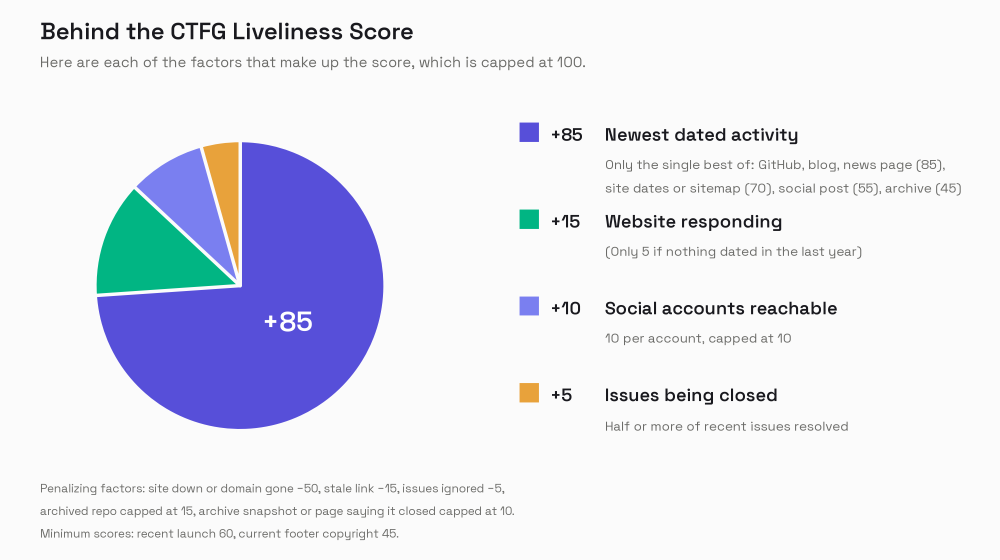

# liveliness

Estimates whether a project is still active from what it publishes: its website, code repository, feeds and social accounts. It returns a score from 0 to 100 and a line-by-line breakdown of how the score was reached.

The [Civic Tech Field Guide](https://civictech.guide) uses it to score the projects in its directory. We publish it so people can see how their project was scored, run it on their own data, and suggest fixes. This repository contains only the scoring code, not the directory.

Every score comes with its `breakdown`, which lists each signal checked, the date found and the points it added. If a project thinks its score is wrong, the breakdown shows what to dispute.

## Install

```sh
pip install git+https://github.com/Civic-Tech-Field-Guide/liveliness
```

It is not on PyPI yet.

Optional:

- `GITHUB_TOKEN`: a personal access token raises the GitHub API limit from 60 calls an hour to 5,000. Each repository takes 4 or 5 calls, plus one or two when you pass an account instead of a repository.
- `YOUTUBE_API_KEY`: needed to read a YouTube channel's last upload. Without it, the channel is only checked for being reachable.
- `python -m playwright install chromium`: needed to read pages that build their text in the browser. Without it, those pages are recorded as unread, not as empty.

## Use

```python
from liveliness import Project, score_project

result = score_project(Project(
    name="liveliness",
    website="https://github.com/Civic-Tech-Field-Guide/liveliness",
    repo="https://github.com/Civic-Tech-Field-Guide/liveliness",
))

result["score"]               # 0 to 100, or None when there was nothing to go on
result["activity_status"]     # Active | Likely Active | Possibly Inactive | Inactive | Unknown
result["last_activity_date"]  # the most recent date from the project itself, ISO 8601, or None
result["status"]              # Active | Inactive | N/A, only where it is unambiguous
result["breakdown"]           # the reasoning, line by line
result["discovered_url"]      # the homepage, when the website given was an article about the project
result["adjudication"]        # set when the rules could not settle the page
```

To log each step:

```python
from liveliness import set_logger
set_logger(print)
```

To cap the time one project takes, pass `budget_s`: `score_project(project, budget_s=110)` stops the sitemap and Wayback Machine checks, which run last, once that many seconds have passed. Without it, those two checks get 40 seconds between them. Either way the sitemap gets at most 15 seconds, so the archive keeps at least the rest, and each request's timeouts are cut to fit the time left. The limit is close to a hard stop: a request that follows redirects can run over by about one timeout per extra redirect. The site's name lookup, which request timeouts don't cover, gets its own limit before the sitemap is read.

`Project` requires only a name. Other fields are used when present, and an empty field never lowers the score. `liveliness/project.py` documents each one.

| Field | What it is |
| --- | --- |
| `website` | The project's homepage. A link to an article about the project also works: the scorer follows its links to find the homepage. |
| `repo` | A GitHub repository, or a GitHub account, in which case its most recently pushed repository is used. |
| `feeds` | RSS or Atom feeds. The scorer also looks for one on the homepage. |
| `links` | Social and other accounts, as `{"url": ..., "type": ...}`. Accounts linked from the homepage are added. |
| `types`, `formats` | What kind of thing the project is. A finished piece of work, such as a report or a book, gets N/A instead of a score. |
| `launch_flag`, `added` | Whether the project recently launched, and when it was added to your directory. |

## Limits

The scorer measures how recently a project showed activity. It does not measure quality, popularity or impact.

When the rules find no date and no statement that a project has ended, the scorer does not guess. It returns an `adjudication` entry and scores the project as if that page had not been read. The caller decides what to do with it. The Field Guide sends those pages to a language model, and a person must approve any reading that would mark a project inactive. `eval/README.md` describes how that was tested and what has not been tested.

## Signals

| Source | What is checked |
| --- | --- |
| Website | Whether it responds, and where the request ends up. |
| GitHub | Last push, latest release, last commit, maintainer activity on issues and pull requests, how much recent issue traffic was resolved, and whether the repository is archived. |
| Blog | The newest entry in an RSS or Atom feed, either supplied or found on the homepage. If a supplied link is the blog page rather than its feed, the scorer looks for the feed that page lists. |
| News pages | Up to two of the site's own blog, news, updates or events pages, found through the homepage's links. The newest dated item counts like a blog post. |
| Social | Last post date for YouTube, Bluesky, Medium, Reddit, Substack, and Mastodon or other fediverse accounts. X, LinkedIn, Facebook, Instagram, TikTok and Signal don't expose post dates, so they are only checked for being reachable. |
| The page itself | Dates the homepage gives for itself, a recent copyright year in the footer, and any statement that the project has closed. |
| Sitemap | Only when nothing above has a date: the newest change the site's sitemap lists for the address. |
| Wayback Machine | Only when the sitemap has no date either: the last time the Internet Archive saw the page change. |

### Website

A success or a redirect counts as live. A certificate error also counts as live.

A 403 or 429 usually means bot blocking, so it doesn't count as down. The scorer tries once more with a headless browser and counts the site as live only if it gets the real page and not the bot check. A timeout or redirect loop is left undetermined. A connection error is retried once, after two seconds.

When a request fails, the scorer checks why:

- If the hostname doesn't resolve, the scorer looks it up again through Cloudflare's and Google's public DNS over HTTPS. If they find it, the site is left undetermined. If not, the address no longer exists.
- If the listed page fails but the site's root answers, the page has moved. This scores as a stale link, not a dead site.
- Otherwise the site did not respond.

If a request ends up on a web archive when the address given was not an archive, the owner has redirected the domain to a snapshot, and the site does not count as live. If the address given is an archive snapshot, the scorer tries the original address inside it first, and the project counts as live if that answers.

Search engine addresses are skipped. A DuckDuckGo "I'm feeling lucky" link is followed to its destination first.

### GitHub

The GitHub signal is the newest of the push, release, commit and issue dates.

Issue dates count only maintainer activity: merged pull requests, anything opened or closed by an owner, member or collaborator, and an outside contributor's issue closed by someone other than its author. An outsider opening an issue doesn't count, because abandoned repositories keep receiving them.

The resolution rate looks at the 20 most recently updated issues and pull requests, keeps those updated in the last 180 days, and counts how many of them were closed or merged in that window. It needs at least 5 items in the window, or it is not applied. It uses the same API request as the issue dates.

### Pages

On the homepage, these count as dates the page gives for itself: schema.org `dateModified` and `datePublished`, common date meta tags, `time` elements, and labeled lines such as "Last updated: 20 March 2026" in the directory's main languages. The server's `Last-Modified` header counts only if it is at least two days old, because a page generated on each request reports the request time.

A news page counts when it lists at least two different dates. The scorer follows only links on the same site, prefers blog and news pages over events pages, skips links to files, and only considers link text of three words or fewer. The link words cover the directory's main languages, for example noticias, actualités, berita, habari and お知らせ. An unlabeled date of today or yesterday is ignored, because many news templates print the current date in the header.

A footer copyright counts when it names this year or last year.

The scorer looks for a closure notice in the first 3,000 characters of the page text, with wording such as "this project has ended" or "no longer accepting submissions". A closure dated in the future is ignored. Registration, applications, nominations, submissions or voting closing don't count, because active projects close those on a schedule.

About one in ten reachable sites sends an empty shell and builds its text in the browser. A page with fewer than 200 characters of readable text is read again with a headless browser. If it still can't be read, it is recorded as unread, and its footer copyright doesn't count.

### Last resorts

The scorer checks two more sources only when nothing the project left is dated within the last 18 months: no recent code, feed, social post, news page or date on the page. Both cost extra requests and both are weaker evidence, so a listing with a recent dated signal never reaches them. An older signal, such as a three-year-old commit, doesn't stop the search for something newer. Both can raise a listing out of Unknown, and neither can lower a score.

The scorer skips both when the site did not respond, the page has moved or the listed address is an archive snapshot, even one whose original still answers, because they would date something that is no longer the project. For a site behind a bot check, it asks only the Wayback Machine, because the same bot check blocks the sitemap.

**Sitemap.** The scorer reads the sitemaps named in the site's `robots.txt` first, then `/sitemap.xml`, `/sitemap_index.xml` and `/wp-sitemap.xml`, and stops at the first one that lists any date, even an old one, because the other names usually serve the same list. An old date still leads to asking the Wayback Machine. It reads up to 10 MB of a sitemap, so a long file's newest entries at the end are read. It follows a sitemap index two levels down and reads up to four child sitemaps from each. It reads children named for the listing's section first, such as `lab-sitemap.xml` for a page under `/lab/`, then the newest, and judges all the entries under one index together. The whole search stops at eight requests or 25 seconds. A sitemap's root element is found after any XML declaration, stylesheet line or comment, however long.

When the address points to a section of a site, only entries at or under that address count. A language root such as `/en/` or `/pt-br/` is the whole site, because many sitemaps list only the default language's pages. Only real ISO 639-1 language codes count, so `/ai/` or `/us/` stays a section. The lab's own pages date a lab's page on a university site, not the university's news. A language root before the section, as in `/en/labs/`, is skipped when the scorer picks which child sitemaps to read first. The scorer skips entries on another site, because `robots.txt` can name someone else's sitemap. When the homepage redirects to the same organization's site, the scorer looks for the sitemap on the host where the homepage landed and keeps entries on that host, so it can read a site that moved under its new name. The listed address still decides which section counts, unless the site moved to another host: then the section is where the homepage landed. A redirect to the same host, with or without `www`, is the same site. A redirect up to a parent host, such as `civiclab.uni.edu` to `www.uni.edu`, never counts, because that is the parent's site. A redirect to a deeper or sibling subdomain, or to another domain, counts only when the page it lands on names the project in its title. A listed page that now redirects to its site's front page was removed, so the scorer keeps to the listed address. Registered domains come from the Public Suffix List, read from the copy bundled with the `tldextract` package, never fetched. On shared hosts such as `github.io`, `netlify.app` or `substack.com`, each customer's subdomain is its own site. The name matches with generic and small words such as AI, app, project, the, for, of or de left out of both the name and the title, so a page titled "Delphi" matches "Delphi AI" and "Code for America" matches its own title, and only when a word of four or more letters is left to match on. A redirect to a funder's, parent's or parking domain dates nothing, and a parking or for-sale page is never trusted: a known parking host, or a short page of under 150 words that says the domain is for sale or parked. A sitemap address that redirects counts only within the same registered domain, and never up to a parent host. Hosts are compared without default ports, and paths without case. Where `robots.txt` itself redirects doesn't count.

The scorer skips the sitemap when a query string picks out the page, such as `project.php?id=12`, because it can't tell which entry is that page. It asks the Wayback Machine about the address with its query. When the homepage redirects, it asks about the page the homepage lands on. For a `#/` or `#!/` route it skips both sources, because the browser builds that page and the archive only sees the shell.

The newest `lastmod` counts like a date the page gives for itself, but only if it is 18 months old or newer. At 18 months it scores 40, and the 5 points for a responding site bring it to 45, the bottom of Likely Active. An older `lastmod` counts for nothing, and the scorer asks the Wayback Machine instead. It also asks the archive when the sitemap's newest date is over a year old, and the higher of the two scores counts. When the sitemap holds both a page date over a year old and a recent publish, the publish counts, because it scores higher, and the page date is still reported as the last activity date.

The scorer judges these rules on every entry on the site before it picks out the listing's section, because a regeneration stamps the whole file and a section of a few pages would slip under every threshold. These `lastmod` values don't count:

- A date of today or yesterday, because a sitemap generated on each request stamps every entry with the request time.
- A date on a page the CMS creates on install, such as WordPress's `/sample-page/` and `/hello-world/`, because it says the site was installed, not kept up.
- One day carrying at least 1,000 entries and at least half the file, because a large site restamped in one day is the platform regenerating its sitemap. The scorer sets those aside like a generator pass.
- One run of times on at least 80% of five or more entries, or one bare date on at least 80% of twenty or more, because a generator wrote those entries in one pass. Times count as one run while each is within two minutes of the one before, after converting each to UTC, so a run that crosses midnight or mixes time zones is still one run. The scorer sets them aside even when they are the newest, and dates the site from the rest, if anything is left. If nothing is left and the pass is within the last year, it counts as a publish of the whole site: someone is keeping the site up. A publish scores 45, the same as a Wayback Machine change, never earns the points for a responding website, and isn't reported as the last activity date.

**Wayback Machine.** The Internet Archive stores a hash of each capture, so a new hash means the content changed. The scorer asks for every day the archive captured the address over the last 400 days, one capture a day, and needs captures on at least four different days. When the archive gives up on that query for a heavily archived page and answers with nothing, the scorer asks again for the latest 60 days of captures. It counts revisits, where the archive saw the same content again. It drops captures that aren't HTML and archived records under 400 bytes, which are usually the archive hitting a bot check or a redirect. The archive later getting past the check is not the site changing.

The first capture of the current content dates the last change. The scorer uses it only if both that capture and the one before it fall within the last year. The archive's capture schedule is too weak evidence to call a project stopped, and after a long gap between captures the change could have come at any point in it. The scorer ignores a page that didn't change across those captures, because its last change came before them.

In a sample of 60 undated listings checked in November 2026, 48 got a new hash on nearly every capture, from a form token, a rotating banner or two versions the server alternates between. When over half the recent captures differ from the one before, or the page flips back to an earlier version, the hashes can't date a change.

For a homepage, including a language root such as `/en/`, the scorer then reads the archived pages themselves, when the page the homepage lands on is a homepage too. It reads at most five: the newest capture and the one before it, which must agree, so the current text is settled; the one nearest six months back; the one nearest a year back if the six-month one reads the same; and one beside the capture that differs. The current text must differ from every earlier text read, so a page alternating between two versions dates nothing. A change needs at least 10 different words, so digits, dates and counters don't count. The first capture after the last one read with the earlier text dates the change, which is the earliest the current text can have appeared. A change counts only when the earlier text held for at least two captures, so a carousel or feed that rewrites part of the page on every capture dates nothing. The scorer skips any that are bot checks, have fewer than 30 words or meet a server error, and counts nothing if the text didn't change within the year.

A deeper page, or one picked out by its query string, keeps to the hashes. On an institution's site such a page's text changes with the host's news box, not with the listing.

The scorer doesn't use the archive when:

- The page builds its text in the browser, because its script file gets a new name on every deploy.
- A footer copyright from this year or last already sets the same floor.

The archive is the main way to reach sites that block this checker. It is weak evidence: a change within a year scores 45, the same as a recent footer copyright. It never earns the points for a responding website, and the scorer doesn't report it as the last activity date, because it records when the archive looked, not anything the project did.

The archive allows about 15 requests a minute, so the scorer waits four seconds between requests. After a refusal, a server error, or two archive searches in a row that had at least five seconds and got no answer, it leaves the archive alone for ten minutes and counts those as no evidence. A search the scorer cut below five seconds to fit its time limit, or a failed or erroring year-long search it is about to retry with a shorter one, doesn't count toward that.

### Dates

Dates more than a day in the future, or before 2000, are discarded. Publishers set their own commit, feed and post dates, and a wrong clock would otherwise keep a score at the top.

## Scoring



`docs/factors_chart.py` draws the chart from the package's own numbers.

Each dated signal gets points by age. The best single signal sets the base score. Signals are not added together.

| Age of the date | GitHub, blog, news page | The page's own date, sitemap | Social post | Wayback Machine change |
| --- | --- | --- | --- | --- |
| 90 days or less | 85 | 70 | 55 | 45 |
| 180 days or less | 80 | 65 | 50 | 45 |
| 1 year or less | 70 | 55 | 45 | 45 |
| 18 months or less | 55 | 40 | 0 | 0 |
| 3 years or less | 35 | 25 (not sitemap) | 0 | 0 |
| 5 years or less | 15 | 10 (not sitemap) | 0 | 0 |
| Older | 5 | 3 (not sitemap) | 0 | 0 |

A date the page gives for itself scores lower than a commit, because content systems update `dateModified` when a template changes and hand-written "last updated" lines go stale. It scores higher than a social post because it comes from the project's own site. A sitemap `lastmod` is the site giving the same kind of date in another file, so it scores the same, up to 18 months old. A Wayback Machine change within a year scores 45, the same floor as a recent footer copyright, because both show that someone is keeping the page up. An archived GitHub repository counts for at most 15.

The scorer then adjusts the base score in this order, keeping it between 0 and 100:

1. **Issue resolution.** Closing or merging at least half of recent issue traffic adds 5. Closing none subtracts 5. Anything in between changes nothing. Archived repositories are skipped.
2. **Website.** One of these applies:
   - The address is an archive snapshot and the original doesn't answer: capped at 10.
   - The site responds: plus 15 if the newest dated signal is within a year, plus 5 if it is older or there is none. A Wayback Machine change doesn't count as a dated signal here.
   - The listed page has moved but the site still answers: minus 15.
   - The address no longer exists: minus 50.
   - The site did not respond: minus 50.
3. **Social reachability.** Any reachable social or other account adds 10 in total.
4. **Footer copyright.** A copyright line naming this year or last raises the score to at least 45.
5. **Recent launch.** A project added to your directory in the last nine months with its launch flag set is raised to at least 60. This doesn't apply when the site did not respond or the address is an archive snapshot.
6. **Closure.** A page saying the project has closed caps the score at 10. This step runs last.

The floors at 45 and 60 only raise scores. They never lower a higher one.

| Score | Activity status |
| --- | --- |
| 70 and above | Active |
| 45 to 69 | Likely Active |
| 20 to 44 | Possibly Inactive |
| below 20 | Inactive |

### Unknown

When the scorer finds no dates, including in the sitemap and the Wayback Machine, and no closure, recent launch, recent copyright or archive snapshot, the result is Unknown and `score` is `None`. A website that loads only shows the address still works, so it isn't scored on its own. A site that doesn't respond is scored, not Unknown.

### Status

`status` is stricter than `activity_status` and is only set at the ends of the range:

- **Active** at 70 and above, unless the only dates come from the sitemap or the Wayback Machine. Those are too weak to set Status, so it stays empty.
- **Inactive** below 20, and only when the site can't be reached or the page says the project has closed. The scorer checks an unreachable site once more, after five seconds. A moved page never counts as unreachable. A low score on a site that still loads leaves `status` empty, because an old guide or dataset is still usable while it's online.
- **N/A** for a finished piece of work, such as a report or a book. A project that also has an ongoing type, such as an organization that published a report, is scored normally.
- Empty otherwise.

## The breakdown

`breakdown` is plain text. It names the signal that set the base score, lists the other dated signals, and gives each adjustment with its points:

```
Strongest signal: GitHub push, 8 months ago (70)
Also found: Bluesky post 30 days ago (55)
11 of the 20 issues and pull requests active in the last 6 months were closed or merged (+5)
Website is responding (+15)
1 social account reachable (+10)
Total: 100 out of 100 - Active
```

Each line shows the points actually applied, so the lines add up to the total. When the 0 or 100 limit cuts an adjustment short, the line says so.

## The reading pass

Some pages need reading, not keyword matching. A conference closes registration because it is about to happen, and a consultation closes because it is over. Both pages say "closed".

When the scorer can read a page but finds no date, no news page and no closure, it sets `adjudication` to the project's name, address and up to 6,000 characters of page text. A sitemap or Wayback Machine date doesn't change this, because a homepage rewritten to announce a closure is exactly the change the archive sees. The score doesn't change. The Field Guide sends these pages to a language model, and a person must approve any reading that would mark a project inactive. `eval/README.md` describes the testing.

The evaluation set is not published because it contains copies of other people's web pages.

## Settings

| Environment variable | Effect |
| --- | --- |
| `GITHUB_TOKEN` | Raises the GitHub API limit. |
| `YOUTUBE_API_KEY` | Reads YouTube upload dates. |
| `RENDER_THIN_PAGES=0` | Never uses the headless browser. |
| `ADJUDICATE=0` | Never sets `adjudication`. |

## Contributing

If your project's score doesn't match what its `breakdown` shows, or you think a rule is wrong, please open an issue.

## License

MIT.
